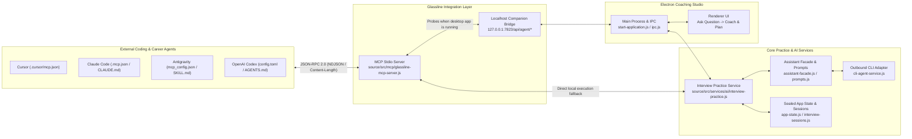

# Glassline — Interactive Interview Practice Simulator & Multi-Agent Coaching Studio

> **Academic & Career-Readiness Engineering Platform** combining structured text-based mock interviews, rubric-driven answer rewriting (**"How to Respond Instead"**), personalized **Actionable Improvement Plans**, and native **Model Context Protocol (MCP)** + **REST** connectivity for **Cursor**, **Claude Code**, **Antigravity**, and **OpenAI Codex CLI**.

---

## Project Motivation & Academic Framing

Traditional interview preparation tools either rely on static question banks without personalized critique, or focus on real-time meeting overlays unsuitable for transparent academic study. **Glassline** is re-architected around deliberate, reflective text-based interview training:

1. **Interactive Text Q&A Loop:** The AI interviewer poses a single targeted technical or behavioral question tailored to the student or candidate's domain (`coding`, `system-design`, `behavioral`, `conceptual`, or `mixed`), target seniority (`junior` to `staff`), preferred programming language, and pinned resume / role context.
2. **Written Candidate Reasoning:** Instead of passive consumption, the learner writes out a structured technical explanation, code design, or STAR story in text.
3. **Structured Critique, Rewrite & Study Plan:** Glassline evaluates the written submission across four fixed sections:
   - `## Evaluation & Rubric Score` — Numerical score (`/10`) plus ratings for clarity, technical depth, structure, and completeness.
   - `## Strengths & Gaps` — Concrete strengths preserved alongside missing edge cases, complexity bounds, failure modes, or unclear framing.
   - `## How to Respond Instead (Model Answer)` — A complete, interview-ready rewrite modeling high-signal phrasing and trade-offs.
   - `## Actionable Improvement Plan` — Focused follow-up drills, conceptual topics to review, and a targeted follow-up question.
4. **Offline Rubric Fallback + Cloud LLM Support:** Works out-of-the-box for offline evaluation and automated academic demos via deterministic heuristic scoring (`Built-in Rubric Mode`), and seamlessly upgrades to live streaming AI generation when Gemini or Portkey credentials (or a connected CLI agent) are configured.
5. **First-Class Multi-Agent Interoperability:** Exposes candidate context, mock-interview generation/evaluation, and persistent study notes directly to **Cursor**, **Claude Code**, **Antigravity**, and **OpenAI Codex** through a zero-dependency stdio MCP server, a localhost companion HTTP bridge, and outbound CLI adapters.

---

## System Architecture



---

## Key Capabilities

| Capability | Module | Description |
| :--- | :--- | :--- |
| **Practice Question Generator** | `source/src/services/ai/interview-practice.js` | Generates non-repeating questions across `mixed`, `coding`, `system-design`, `behavioral`, and `conceptual` domains with difficulty calibration (`junior`, `mid`, `senior`, `staff`). |
| **Rubric Evaluator & Model Rewriter** | `source/src/services/ai/interview-practice.js` | Scores written answers and returns `Evaluation & Rubric Score`, `Strengths & Gaps`, `How to Respond Instead (Model Answer)`, and `Actionable Improvement Plan`. |
| **Desktop Practice UI** | `source/src/windows/assistant/` | Domain selector (`#practice-domain-select`), `Ask Question` (`#practice-question-btn`), `Coach & Plan` (`#practice-evaluate-btn`), and automatic evaluation on chat submission during active rounds. |
| **Multi-Agent MCP Server** | `source/src/mcp/glassline-mcp-server.js` | Exposes 6 MCP tools and 2 resources over stdio (`Content-Length` & NDJSON auto-detection). |
| **Localhost Companion REST API** | `source/src/main-process/features/mobile-server/server.js` | Loopback-only endpoints (`GET /api/agent/status`, `GET /api/agent/context`, `POST /api/agent/practice/question`, `POST /api/agent/practice/evaluate`) synchronized with the live desktop session. |
| **Outbound CLI Agent Adapter** | `source/src/services/ai/cli-agent-service.js` | `contracts.js`-compliant adapter invoking `claude`, `codex`, `agy`, or `cursor` CLIs for local workflows. |
| **Encrypted State & Context Controls** | `source/src/services/state/app-state.js` | Persists API keys, pinned resume/job descriptions, durable study notes, and archived practice sessions (`MAX_INTERVIEW_SESSIONS = 10`). |

---

## Quick Start

### 1. Install Dependencies
```bash
git clone https://github.com/Rvin-zh/glassline.git
cd glassline/source
npm ci
```

### 2. Generate & Verify Agent Integrations (Cursor, Claude Code, Antigravity, Codex)
```bash
npm run agents:setup
npm run agents:verify
```
This validates all 9 generated integration files and runs an end-to-end stdio MCP handshake verifying tool discovery, practice question generation, answer evaluation, and durable study note persistence.

### 3. Run Automated Tests
```bash
cd source
npm test
```

### 4. Launch the Desktop Coaching Studio or Standalone MCP Server
```bash
# Launch Electron desktop UI
cd source && npm start

# Or run the MCP server standalone (for IDE agent hosts)
cd source && npm run mcp
```

Platform-specific setup notes are available in [`source/MAC.md`](source/MAC.md) and [`source/FEDORA.md`](source/FEDORA.md).

---

## Connect Your Coding Agent in Minutes

- **Cursor:** Workspace config is pre-generated in [`.cursor/mcp.json`](.cursor/mcp.json) and templated in [`integrations/cursor/mcp.json`](integrations/cursor/mcp.json). Enable the `glassline` server under Cursor Settings -> MCP.
- **Claude Code:** Workspace MCP definition is in [`.mcp.json`](.mcp.json) with coaching instructions in [`CLAUDE.md`](CLAUDE.md) (template also in [`integrations/claude-code/.mcp.json`](integrations/claude-code/.mcp.json)).
- **Antigravity:** Import [`integrations/antigravity/mcp_config.json`](integrations/antigravity/mcp_config.json) and load [`integrations/antigravity/SKILL.md`](integrations/antigravity/SKILL.md) as the coaching workflow skill.
- **OpenAI Codex CLI:** Add [`integrations/codex/config.toml`](integrations/codex/config.toml) to `~/.codex/config.toml` or workspace `.codex/config.toml`; root agent conventions live in [`AGENTS.md`](AGENTS.md).

For machine-global configs (`~/.cursor/`, `~/.codex/`, `~/.gemini/antigravity/`), run:
```bash
cd source && npm run agents:setup -- --absolute
```

---

## Documentation Suite

| Document | Audience & Focus |
| :--- | :--- |
| [`docs/ARCHITECTURE.md`](docs/ARCHITECTURE.md) | Deep dive into Electron main/preload/renderer boundaries, AI adapter contracts, prompt caching, and hybrid MCP + HTTP synchronization. |
| [`docs/INTERVIEW_PRACTICE_GUIDE.md`](docs/INTERVIEW_PRACTICE_GUIDE.md) | Detailed walkthrough of the text-based Q&A practice loop, rubric dimensions, **"How to Respond Instead"** rewriting strategy, and study note retention. |
| [`docs/AGENT_INTEGRATIONS.md`](docs/AGENT_INTEGRATIONS.md) | Step-by-step configuration, verification, and outbound CLI adapter setup for Cursor, Claude Code, Antigravity, and Codex. |
| [`docs/API_AND_MCP_REFERENCE.md`](docs/API_AND_MCP_REFERENCE.md) | Complete specification of MCP tools/resources, Electron IPC channels, preload methods, and companion HTTP REST endpoints. |
| [`source/README.md`](source/README.md) | Developer runbook, npm scripts, environment variables, and module map inside `source/`. |

---

## Repository Structure

```text
glassline/
├── README.md                              # Project overview & academic showcase
├── CLAUDE.md                              # Claude Code agent instructions
├── AGENTS.md                              # Codex & universal agent instructions
├── .mcp.json                              # Claude Code project MCP configuration
├── .cursor/mcp.json                       # Cursor workspace MCP configuration
├── integrations/                          # Portable templates for all 4 supported agents
│   ├── antigravity/                       # mcp_config.json + SKILL.md
│   ├── claude-code/                       # .mcp.json
│   ├── codex/                             # config.toml
│   └── cursor/                            # mcp.json
├── docs/                                  # Detailed architecture, practice, integration & API docs
│   ├── ARCHITECTURE.md
│   ├── INTERVIEW_PRACTICE_GUIDE.md
│   ├── AGENT_INTEGRATIONS.md
│   └── API_AND_MCP_REFERENCE.md
└── source/                                # Application source, scripts, and Node test suite
    ├── package.json
    ├── scripts/
    │   ├── run-mcp-server.js              # Stdio MCP server entrypoint
    │   └── setup-agent-integrations.js    # Integration generator & --verify runner
    ├── src/
    │   ├── mcp/glassline-mcp-server.js    # JSON-RPC 2.0 MCP server implementation
    │   ├── services/ai/
    │   │   ├── interview-practice.js      # Question bank, prompts, evaluator, offline rubric
    │   │   ├── cli-agent-service.js       # Contracts-compliant CLI adapter (claude/codex/agy/cursor)
    │   │   ├── assistant-facade.js        # Provider-neutral AI execution & prompt builder facade
    │   │   └── prompts.js                 # Central prompt definitions & exports
    │   ├── main-process/                  # Electron boot, IPC handlers, companion HTTP bridge
    │   └── windows/assistant/             # Desktop coaching studio HTML/CSS/preload/renderer
    └── test/                              # Unit & integration test suites
```

---

## License & Provenance

Glassline is distributed under the MIT License (`source/LICENSE`). Originally derived from Open-Cluely and adapted for transparent academic interview preparation, structured self-critique, and multi-agent software engineering workflows.
