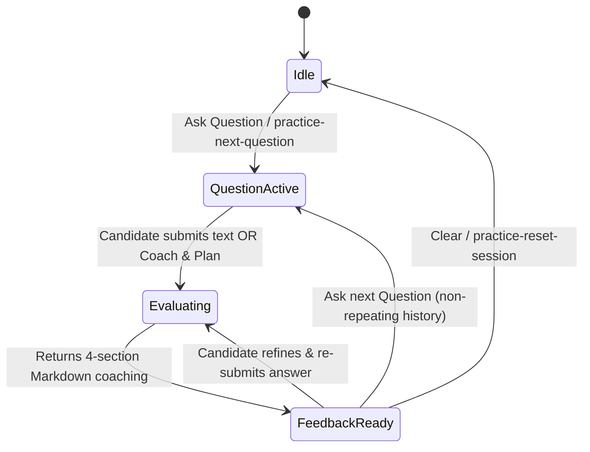

# Glassline Architecture Specification

This document describes the modular software architecture of **Glassline**, detailing how Electron processes, provider-neutral AI services, encrypted persistence, the localhost companion bridge, and the MCP stdio server coordinate together.

---

## 1. High-Level Architectural Layers

Glassline follows a strict layered boundary model (documented originally in `source/notes.md` and extended for practice & multi-agent tooling):

1. **Presentation Layer (`source/src/windows/assistant/`)**
   - Pure browser DOM + vanilla ES module UI (`renderer.html`, `styles.css`, `renderer.js`, `renderer/features/*`).
   - Communicates exclusively via the hardened `contextBridge` API defined in `preload/actions.js`.
2. **Process & Transport Layer (`source/src/main-process/` & `source/src/mcp/`)**
   - Electron IPC handlers (`features/assistant/ipc.js`, `features/assistant/context-services-ipc.js`, `features/settings/ipc.js`).
   - Companion HTTP/WebSocket bridge (`features/mobile-server/server.js`) exposing loopback-only `/api/agent/*` JSON endpoints alongside the LAN mobile UI.
   - Standalone JSON-RPC 2.0 MCP stdio server (`src/mcp/glassline-mcp-server.js`).
3. **Domain & AI Orchestration Layer (`source/src/services/ai/`)**
   - `interview-practice.js`: Domain-typed practice state machine, question prompts, rubric coaching prompts, and offline heuristic fallback evaluator.
   - `assistant-facade.js`: Provider-neutral facade unifying `GeminiService`, `PortkeyService`, and `CliAgentService` with execution-generation guards and prompt cache awareness.
   - `contracts.js`: Runtime duck-type verification (`assertAiAdapter`) guaranteeing every AI adapter exposes identical capabilities and retry/auth error classifiers.
4. **Persistence & Context Lifecycle Layer (`source/src/services/state/` & `source/src/services/context/`)**
   - `app-state.js`: Sealed storage for sensitive secrets, pinned resume/job text, approved durable study notes, and preferences under `OPEN_CLUELY_STATE_DIR` or OS `userData`.
   - `interview-sessions.js`: Bounded rolling archive (`MAX_INTERVIEW_SESSIONS = 10`) tracking session summaries across launches.

---

## 2. Shared Stateful Composition in Electron (`start-application.js`)

At application startup in `source/src/main-process/start-application.js`, a single shared `practiceService` is constructed using lazy closures:

```js
const practiceService = createInterviewPracticeService({
  getAdapter: () => (geminiRuntime.isAiReady() ? geminiRuntime.getService() : null),
  executeWithAdapter: (fn) => geminiRuntime.executeWithKeyFailover(fn),
  getContextTexts: () => contextServices?.documentService?.getPinnedDocumentTexts?.() || {
    resume: appState?.resumeText || '',
    jobDescription: appState?.jobDescriptionText || ''
  },
  getProgrammingLanguage: () => geminiRuntime.getActiveProgrammingLanguage() || 'Python'
});
```

Passing that single `practiceService` instance to **both** `registerAssistantIpc(...)` and `createMobileServer(...)` ensures:
- A question generated via the desktop **Ask Question** button can be evaluated or inspected through `/api/agent/context` and `/api/agent/practice/evaluate` by a connected agent.
- Key rotation and Portkey/Gemini failover in `geminiRuntime.executeWithKeyFailover` protect practice requests without duplicating retry logic.
- When `contextServices` finishes initializing inside `app.whenReady()`, the lazy `getContextTexts` closure automatically begins supplying live pinned resume and job-description documents.

---

## 3. Text-Based Interactive Practice State Machine



### Dual-Mode Execution (Live LLM vs Offline Rubric)
`createInterviewPracticeService` checks `adapter.isReady()`:
- **Configured AI Mode (`adapter.isReady() === true`)**: Invokes `runTextGeneration(adapter, prompt, { executionContext, onChunk })`, streaming response chunks directly to the UI via `ai-stream-start`, `ai-stream-chunk`, and `ai-stream-end` events while respecting generation invalidation guards.
- **Built-in Rubric Mode (`adapter.isReady() === false` and `allowOfflineFallback !== false`)**: Selects a non-repeating question from `OFFLINE_QUESTION_BANK` across the requested domain (`coding`, `system-design`, `behavioral`, `conceptual`, or rotating in `mixed`), and evaluates candidate responses via `scoreOfflineAnswer()` checking substantive length, structural signals (ordered transitions / STAR markers), quantitative complexity/SLA metrics, and failure-mode/edge-case coverage.

---

## 4. Hybrid MCP + Companion Bridge Execution

The stdio MCP server (`glassline-mcp-server.js`) avoids requiring a heavy IDE runtime or external SDK dependencies:

1. **Auto-Detected Framing (`startStdio`)**
   - Buffers incoming `stdin` chunks and inspects the prefix:
     - If `Content-Length:` headers are detected, parses byte-counted LSP-style payloads and replies using `Content-Length` framing.
     - Otherwise, parses newline-delimited JSON (`ndjson`) lines and replies with `\n`-terminated JSON.
   - This makes one binary compatible with Cursor, Claude Code, Antigravity, OpenAI Codex CLI, and custom Python/Node test harnesses.
2. **Loopback Companion Probe vs Local Fallback**
   - Before executing context, question, or evaluation tools, `glassline-mcp-server.js` sends a fast (900ms timeout) request to `http://127.0.0.1:7823/api/agent/*` (unless `GLASSLINE_MCP_DISABLE_BRIDGE_PROBE=1`).
   - If the Glassline desktop app is open, requests synchronize directly with the active Electron session.
   - If the desktop app is closed, the MCP server loads sealed local state (`loadAppState`), builds a headless `GeminiService` or `PortkeyService` adapter if configured (or uses Built-in Rubric Mode), and handles all requests autonomously.
3. **Host Boundary Security**
   - Although the mobile web companion binds `0.0.0.0:7823` so LAN phones can pair, `handleAgentRequest()` explicitly rejects any `/api/agent/*` request whose `req.socket.remoteAddress` is not loopback (`127.0.0.1`, `::1`, `::ffff:127.0.0.1`, `localhost`) with HTTP `403 Forbidden`.
   - External tools cannot inspect raw API keys over `/api/agent/context` or MCP tools: only sanitized metadata (`aiReady`, `provider`, `model`, `resume`, `jobDescription`, `durableNotes`, session summaries) is exposed.

---

## 5. Outbound CLI Agent Adapter (`CliAgentService`)

`source/src/services/ai/cli-agent-service.js` reverses the direction of integration: instead of an IDE calling Glassline, Glassline can delegate text generation to locally authenticated developer CLIs (`claude`, `codex`, `agy`, `cursor`) while remaining indistinguishable from `GeminiService` or `PortkeyService` to `assistant-facade.js`. All invocations enforce `assertAiAdapter()`, timeouts (`timeoutMs`), bounded conversation history, and normalized error classifiers (`isQuotaExhaustedError`, `isAuthenticationError`, `isRetryableError`).
